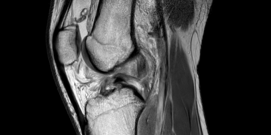
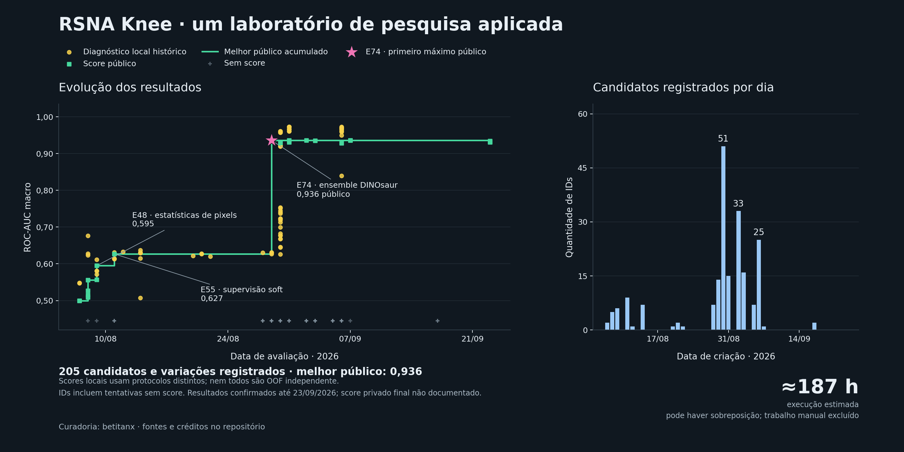

# Kaggle RSNA Knee Abnormality Detection

[](https://www.kaggle.com/competitions/rsna-knee-abnormality-detection)

Um laboratório de pesquisa aplicada para classificação de anormalidades em ressonâncias magnéticas do joelho: hipóteses, experimentos, validação e aprendizado com resultados que nem sempre melhoraram.

**Melhor score público registrado: 0,936 ROC-AUC macro · 205 candidatos/variações registrados · ≈187 horas estimadas de execução.**



## Sobre o projeto

Desenvolvi este projeto para explorar a competição [RSNA Knee Abnormality Detection](https://www.kaggle.com/competitions/rsna-knee-abnormality-detection), construindo com assistência de agentes de IA uma esteira de pesquisa que registra hipóteses, compara candidatos, valida artefatos e acompanha resultados no Kaggle.

O trabalho começou com baselines de texto, metadados e estatísticas de pixels e evoluiu para reprodução e adaptação de ensembles públicos, experimentos de supervisão fraca e auditorias de validação. A melhor execução pública registrada foi **E74, com 0,936**, baseada na solução pública DINOsaur V4.9. A contribuição deste projeto está na engenharia da esteira, nas reproduções, nas ablações e na análise crítica; a arquitetura campeã e os pesos públicos têm seus próprios autores, relacionados em [Referências e atribuição](docs/referencias.md).

Esta é uma seleção dos recursos mais relevantes para portfólio. Os resultados são o último estado confirmado nos registros, em **23/09/2026**. Não foi verificado aqui o score privado final nem a colocação após o encerramento da competição.

## Resultados selecionados

### Top 3 soluções preservadas

| Posição editorial | Solução | Score público | Diferencial | Notebook |
|---|---|---:|---|---|
| **1** | **E74** | **0,936** | Ensemble DINOsaur V4.9; primeiro máximo confirmado | [Inferência E74](notebooks/01_e74_dinosaur_v49.ipynb) |
| **2** | **E109** | **0,936** | Peso adaptativo do Raptor segundo o desacordo com o Transformer | [Inferência E109](notebooks/02_e109_transformer_adaptativo.ipynb) |
| **3** | **E130** | **0,936** | Agregação por margem majoritária entre três braços | [Inferência E130](notebooks/03_e130_margem_majoritaria.ipynb) |

As três empataram no score público registrado. A ordem usa a data de confirmação: E74 em 29/08, E109 em 31/08 e E130 em 02/09/2026. E207 e E208 também empataram em 0,936 posteriormente. Esta seleção não afirma superioridade estatística entre soluções empatadas. Veja o [catálogo das soluções](docs/top3.md).

### Outros marcos

| Experimento | Abordagem | Score público |
|---|---|---:|
| E44 | Metadados DICOM e combinação em cadeia | 0,557 |
| E48 | Estatísticas de pixels | 0,595 |
| E55 | Regressão com supervisão soft de pixels | 0,627 |
| **E74** | **Reprodução DINOsaur V4.9, ensemble visual** | **0,936** |
| E75 | Reprodução de outra versão pública | 0,935 |
| E204 | Transformer 85% + Raptor 15% | 0,928 |
| E120 | Consenso logit E74–E118 | 0,934 |
| E121 | Consenso logit por alvo | 0,933 |
| E122 / E125 | Consenso fraco / shrinkage de Fracture | 0,932 |
| E123 | Proteção de alvos estáveis | 0,931 |

E109, E130, E207 e E208 também chegaram a 0,936, sem superar o primeiro máximo do E74. Os números acima são públicos, não resultados clínicos nem scores privados finais.

Os 205 registros representam IDs de candidatos e variações, inclusive tentativas sem score; não equivalem a 205 modelos treinados ou submissões. As ≈187 horas combinam 169 h 40 min de duas execuções longas com aproximadamente 17 h de runtime deduplicado; pode haver sobreposição e o trabalho manual não foi contabilizado.

## O que este repositório demonstra

- Organização de pesquisa iterativa com hipóteses e resultados rastreáveis.
- Separação de pacientes/estudos na validação, métricas por alvo e análise de estabilidade.
- Fusão de probabilidades, ranks e logits, com seleção e avaliação em conjuntos separados.
- Validação de CSVs, hashes de artefatos e controle local de orçamento de submissões.
- Auditoria de vazamento, reutilização do conjunto de seleção e limitações da supervisão por laudos.

O aprendizado central foi que **melhorar um diagnóstico local não garante melhora no leaderboard**. As cinco últimas sondagens tiveram diagnósticos locais entre 0,9670 e 0,9729 nos mesmos estudos gold já expostos, mas resultados públicos de 0,931 a 0,934. Esses diagnósticos não são OOF independente. A distinção é detalhada em [Metodologia e limites](docs/metodologia.md).

## Estrutura

```text
docs/                 Metodologia, reprodução, referências e gráfico
resultados/           Histórico agregado e resultados selecionados
notebooks/            Três notebooks reais de inferência: E74, E109 e E130
src/rsna_knee/        Núcleo selecionado de validação, fusão e submissões
tests/                Testes dos módulos selecionados
scripts/              Regeneração do gráfico
lab.md                Síntese dos experimentos e aprendizados
```

## Executar localmente

Requer Python 3.11 ou superior. O núcleo e os exemplos usam CPU e não precisam dos exames da competição.

```bash
python -m pip install -e ".[dev,visualizacao,notebooks]"
python -m pytest
python scripts/gerar_progresso.py
```

Os notebooks reais precisam de ambiente Kaggle, acelerador e inputs externos. Eles não fazem parte dos testes locais em CPU. Para abrir o código localmente, use `jupyter notebook notebooks/01_e74_dinosaur_v49.ipynb`; para executá-lo, siga o [guia de reprodução](docs/reproducao.md).

## Recursos

- [Diário resumido](lab.md)
- [Top 3 soluções e critério de ordenação](docs/top3.md)
- [Metodologia e limitações](docs/metodologia.md)
- [Reprodução e proveniência do E74](docs/reproducao.md)
- [Fontes e créditos](docs/referencias.md)
- [Histórico agregado usado no gráfico](resultados/historico.json)

Dados de exames, laudos, identificadores de pacientes, checkpoints, credenciais e logs operacionais não fazem parte desta publicação. Os notebooks derivados preservam os créditos e a licença Apache 2.0 do código público de origem; consulte o [aviso de atribuição](notebooks/NOTICE.md). O código é apresentado como material de pesquisa e portfólio, sem validação para uso clínico.
